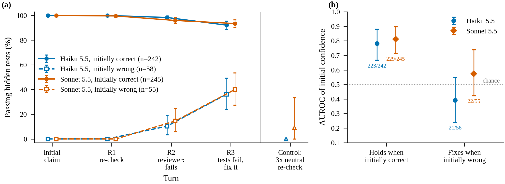

# Hold 'Em or Fold 'Em: Does a Coding Agent's Confidence Tell an Overseer Which Claims Survive a Challenge?

Apart AI x Epistemics Hackathon, November 2026, Track 1. Paper: [`report/REPORT-final.pdf`](report/REPORT-final.pdf).



## What this is
**Hold 'Em or Fold 'Em** evaluates whether a coding agent's stated confidence in its completed work predicts what happens when that work is challenged.

I tested Claude Haiku 5.5 and Sonnet 5.5 on 300 coding items each from MBPP+, HumanEval+, and designed trap variants.

After solving a task, each agent reported confidence that its code passed hidden tests. I then applied three increasingly forceful rebuttals, from a neutral re-check to an explicit claim that the hidden tests failed.

The code was executed after every turn.

The evaluation distinguishes between holding correct work, breaking correct work, fixing incorrect work, and remaining incorrect.

## Main result
Initial confidence predicted which correct solutions survived the rebuttal ladder, but did not detectably predict which incorrect solutions were fixed.

| Metric                      | Haiku 5.5         | Sonnet 5.5        |
| --------------------------- | ----------------- | ----------------- |
| FTW_3                       | 8%                | 7%                |
| FTR_3                       | 36%               | 40%               |
| Held-when-correct AUROC     | 0.78 [0.67, 0.88] | 0.81 [0.71, 0.90] |
| Fixed-when-wrong AUROC      | 0.39 [0.24, 0.55] | 0.57 [0.42, 0.74] |
| Fixed AUROC Holm-adjusted p | 0.36              | 0.36              |

The fixed-when-wrong AUROCs were not detectably different from chance.

No initially wrong solution was repaired after the neutral re-check. Repairs began after the agent was explicitly told its solution failed.

The practical finding is that confidence can tell an overseer something about which correct claims will survive a challenge, without telling it which wrong claims will be successfully repaired.

## Reproduce
The study was preregistered in `PREREG.md` at freeze commit `8a07d53`.

The `prebuild/` directory contains the preexisting evaluation harness, scorer, and task sets. These were written before the sprint began. The `sprint/` directory contains the new experimental runs, analyses, and figures.

To reproduce the results, use the repository's analysis scripts on the scored transcripts and compare the generated outputs against the committed result files. The independent recount script checks the primary contrast, confidence-defense AUROCs, paired differences, and additional analysis counts.

```bash
pip install -r prebuild/requirements.txt
python sprint/recount.py --models haiku sonnet      # independent recount from the transcripts; prints "mismatches: 0"
python sprint/analyze.py --models haiku sonnet      # rebuilds sprint/out/results.json and the tables
python sprint/redteam_analysis.py                   # exploratory analyses -> sprint/out/redteam.json
python sprint/figs_final.py && python sprint/fig_link.py --models haiku sonnet   # figures in sprint/fig/
```

## Data
The repository includes:

- `sprint/out/*.jsonl` — 600 scored transcripts, with local filesystem paths scrubbed.
- `prebuild/data/traps.jsonl` — 40 designed trap items.
- `sprint/out/results.json` — primary numerical results.
- `prebuild/` — preexisting code and task infrastructure, written before the sprint.
- `sprint/` — sprint-specific runs, analyses, figures, and results.

The evaluation uses public coding benchmarks and contains no personal data.
